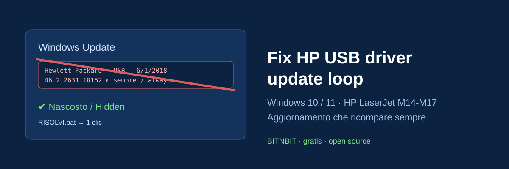

# Fix: "Hewlett-Packard - USB - 6/1/2018 - 46.2.2631.18152" ricompare sempre in Windows Update

**IT** · Windows Update propone di continuo l'aggiornamento
`Hewlett-Packard - USB - 6/1/2018 12:00:00 AM - 46.2.2631.18152`
(driver `HP LaserJet M14-M17 (REST_WinUSB)`, hardware `USB\VID_03F0&PID_BE2A&MI_01`):
lo installi, riavvii, e torna. Questo script lo **nasconde** in modo ufficiale (API di Windows Update),
senza disattivare gli altri aggiornamenti e senza toccare la stampante, che continua a funzionare.

**EN** · Windows Update keeps offering `Hewlett-Packard - USB - 6/1/2018 12:00:00 AM - 46.2.2631.18152`
again and again (installs, reboots, comes back). This script **hides** that single update through the
official Windows Update API. Other updates and the printer keep working.

## Soluzione in 1 clic / One-click fix
1. Scarica / Download: **Code → Download ZIP** ed estrai / and extract.
2. Doppio clic su / Double-click **`RISOLVI.bat`** → Sì / Yes ai permessi di amministratore.
3. Windows Update → *Controlla aggiornamenti*: non c'è più / it's gone.

## Da PowerShell (amministratore)
```powershell
.\nascondi-aggiornamento.ps1            # nasconde l'aggiornamento HP USB / hide the HP USB update
.\nascondi-aggiornamento.ps1 -Elenca    # elenca i driver in attesa / list pending driver updates
.\nascondi-aggiornamento.ps1 -Titolo "*Realtek*"   # qualsiasi altro driver che ricompare / any other looping driver
.\nascondi-aggiornamento.ps1 -Mostra    # annulla: lo fa ricomparire / undo (unhide)
```

## Perché succede / Why it happens
Il pacchetto HP del 2018 per l'interfaccia USB "REST" delle LaserJet M14-M17 (e simili) risulta sempre
"non installato" per Windows Update, così viene riproposto a ogni controllo. Nasconderlo è la stessa cosa
che faceva il vecchio strumento Microsoft *wushowhide.diagcab* (Mostra o nascondi aggiornamenti).

The 2018 HP package for the LaserJet M14-M17 "REST" USB interface is never detected as installed,
so it is offered again at every scan. Hiding it is what Microsoft's old *wushowhide.diagcab* did.

## Sicuro / Safe
- Nessun dato raccolto, niente internet, niente servizi disattivati. / No data collected, no services disabled.
- Reversibile con `-Mostra`. / Fully reversible with `-Mostra`.
- Testato su Windows 11 Pro 25H2 (2026). / Tested on Windows 11 Pro.

**Parole chiave / Keywords:** HP driver update loop, Windows Update aggiornamento ripetuto, Hewlett-Packard USB 46.2.2631.18152,
HP LaserJet M14 M15 M17 driver, REST_WinUSB, wushowhide, hide driver update Windows 11, nascondere aggiornamento driver,
aggiornamento HP che si reinstalla sempre, Windows Update stuck HP printer driver.

☕ Offrimi un caffè: https://buymeacoffee.com/bitnbit · YouTube: https://www.youtube.com/@bitnbit · Sito: https://bitnbit.com

Licenza MIT · altri strumenti gratuiti: [AI Toner Saver](https://github.com/BITNBIT/ai-toner-saver) (risparmia toner stampando PDF e foto).
